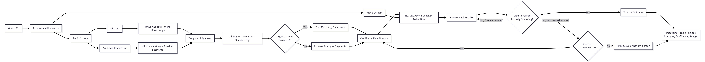

# On-Screen Dialogue Frame Extractor

Locates the exact video frame in which a given line of dialogue is spoken **on-screen**, and returns its timestamp, frame number, extracted text, and the frame image itself. If no target line is provided, the system discovers and returns every verified on-screen dialogue in the video.

"On-screen" specifically means the speaking character is visibly in frame, with mouth movement in sync with the audio at that moment — as distinct from voice-over, off-camera narration, or any case where the audio is heard but the visible person is not the one producing it.

This project was built in response to a technical problem statement requiring exactly this capability, working on an arbitrary public video URL without manual inspection, and generalizing to a different video or target line at evaluation time.

## Contents

- [Overview](#overview)
- [Demo](#demo)
- [Key Features](#key-features)
- [How It Works](#how-it-works)
- [Tech Stack](#tech-stack)
- [Project Structure](#project-structure)
- [Getting Started](#getting-started)
  - [Prerequisites](#prerequisites)
  - [Setup, start to finish](#setup-start-to-finish)
  - [Your first run, step by step](#your-first-run-step-by-step)
  - [Seeing what the system is actually for](#seeing-what-the-system-is-actually-for)
  - [If a download is refused](#if-a-download-is-refused)
  - [CLI reference](#cli-reference)
  - [Running the API](#running-the-api)
  - [Running the web interface](#running-the-web-interface)
  - [Running with Docker](#running-with-docker)
  - [Running Tests](#running-tests)
- [Business Model](#business-model)
  - [What is actually being sold](#what-is-actually-being-sold)
  - [Who pays, and what for](#who-pays-and-what-for)
  - [Unit economics](#unit-economics)
  - [Pricing](#pricing)
  - [Why this is defensible, and where it is not](#why-this-is-defensible-and-where-it-is-not)
  - [Cost to operate today](#cost-to-operate-today)
- [System Parameters](#system-parameters)
  - [The ones you would actually change](#the-ones-you-would-actually-change)
  - [Fixed by measurement, not preference](#fixed-by-measurement-not-preference)
  - [Confidence](#confidence)
  - [Measured performance](#measured-performance)
  - [Operational limits](#operational-limits)
- [Documentation](#documentation)
- [Known Limitations and Future Scope](#known-limitations-and-future-scope)
- [Troubleshooting](#troubleshooting)
- [Author](#author)
- [Contributors](#contributors)
- [Acknowledgments](#acknowledgments)

## Overview

Rather than a single end-to-end model, the system treats the problem as three fused sub-problems: what was said and when (speech recognition), who said it (speaker diarization), and whether the speaker was visibly on camera while saying it (audio-visual active speaker detection). Each stage is independently verifiable, testable, and swappable behind a stable interface.

Two modes share one pipeline:

- **Target search (Mode A):** given a target phrase, locate it in the transcript and verify on-screen status only for the small time window around it. The full video is never visually processed.
- **Discovery (Mode B):** with no target phrase, every detected speech segment is treated as a candidate, verified the same way, and every confirmed on-screen dialogue is returned as a list.

## Demo

Recorded runs of the system are here:

**[Demo videos — Google Drive](https://drive.google.com/drive/folders/1l37cTOoEBebD7bFfVnfk_ZwWOG1AMkwF?usp=sharing)**

They show the two things worth seeing: a target search returning an exact frame
with its timestamp and confidence breakdown, and a discovery sweep sorting every
spoken line into on screen, uncertain, and off camera.

The off-camera bucket is the part to watch. It is what separates this from
caption search, which returns a voice-over and an on-camera delivery as equally
good matches.

## Key Features

- Accurate, word-level dialogue localization via `faster-whisper`, with fuzzy matching tolerant of transcription noise
- Speaker diarization via `pyannote-audio`, aligned to transcript words by greatest temporal overlap
- On-screen verification via NVIDIA's Active Speaker Detection service, cross-checked against the diarized speaker rather than accepting any visible face
- Duration-based temporal smoothing, so a single flickering frame cannot produce a confident wrong answer
- A documented, deterministic confidence formula, with results routed to success, ambiguous, or not-on-screen rather than a bare true or false
- Forced constant frame rate normalization, so frame numbers and timestamps correspond exactly regardless of the source's original frame rate
- Structured error reporting at every stage; a failure in ingestion, transcription, or detection never crashes the process
- A modular architecture built around SOLID principles, so the active-speaker-detection backend, transcriber, or diarizer can each be replaced independently

## How It Works



The full architecture diagram, user flow, edge-case handling, assumptions, and the reasoning behind each design decision — including alternative approaches considered and why they were or were not adopted — are documented in [`docs/approach.md`](docs/approach.md).

## Tech Stack

| Purpose | Technology |
|---|---|
| Video acquisition | `yt-dlp` |
| Media normalization | `FFmpeg` / `FFprobe` |
| Speech transcription | `faster-whisper` |
| Speaker diarization | `pyannote-audio` |
| On-screen verification | NVIDIA Active Speaker Detection (NIM, hosted) |
| Frame extraction | `PyAV` / OpenCV |
| Text matching | `rapidfuzz` |
| API layer | `FastAPI` |
| Configuration | `pydantic-settings` |
| Web interface | `React` + `Vite` + `TypeScript` |

## Project Structure

```
quest1-dialogueextractor/
├── main.py                 # CLI entry point
├── serve.py                # HTTP entry point (uvicorn + FastAPI, also serves the UI)
├── Dockerfile               # Multi-stage, non-root, CPU-only torch by default
├── prompts.txt               # AI/LLM prompts used during development
├── frontend/                 # React + Vite + TypeScript interface
│   ├── src/api/               # Contract mirror, error normalizer, fetch client
│   ├── src/model/              # Wire shapes -> render shapes, label tables
│   ├── src/hooks/               # Submit/poll state machine, health preflight
│   ├── src/components/           # Form, progress, result views
│   └── src/styles/                # Design tokens and stylesheet
├── src/dialogue_extractor/
│   ├── domain/              # Pure data models, timing math, error types
│   ├── interfaces/           # Abstract ports (video source, transcriber, diarizer, ASD provider)
│   ├── ingestion/             # URL validation, acquisition, normalization
│   ├── audio/                  # Transcription, diarization, alignment
│   ├── matching/                 # Text normalization and fuzzy phrase matching
│   ├── vision/                     # Clip building, scene detection, active speaker detection, frame extraction
│   ├── pipeline/                     # Orchestration, both modes, confidence scoring, result building
│   ├── api/                            # FastAPI app, routes, request schemas, in-process job store
│   ├── infra/                            # Logging, retry, caching, FFmpeg wrapper
│   └── composition.py                     # Composition root -- wires concrete stages behind the ports
├── tests/
│   ├── unit/
│   ├── integration/
│   └── e2e/
├── docs/
│   ├── approach.md          # Full design and architecture document
│   └── diagrams/
└── output/                  # Generated results and extracted frame images
```

The full, per-module folder structure and its SOLID rationale are in [`docs/approach.md`](docs/approach.md).

## Getting Started

### Prerequisites

| Requirement | Why | Notes |
|---|---|---|
| **Python 3.11** | `av` and the pinned wheel set were verified against it | 3.12+ untested; 3.10 lacks `StrEnum` |
| **FFmpeg / FFprobe, recent build** | Forced-CFR normalization and scene-cut detection | Debian's default package can be years behind. Check with `ffmpeg -version` |
| **NVIDIA Build API key + ASD function ID** | Active speaker detection | Free tier is sufficient. From the API tab of the [model page](https://build.nvidia.com/nvidia/active-speaker-detection) |
| **Hugging Face token** | The gated `pyannote` diarization pipeline | A token alone is not enough — you must also *accept the terms* on the model page |
| **NVIDIA GPU** | Optional | Accelerates transcription and diarization. Active speaker detection is hosted, so it needs no local GPU either way |
| **Node 20+** | Optional | Only to build the web interface. The CLI needs none |

Roughly **6 GB** of model weights download on first run (Whisper `large-v3` plus
the pyannote pipeline) and are cached thereafter.

### Setup, start to finish

**1 — Install**

```bash
git clone <this-repository-url>
cd quest1-dialogueextractor
python -m venv .venv
```
```bash
.venv/Scripts/activate       # Windows.  macOS/Linux: source .venv/bin/activate
pip install -r requirements.txt
```

**2 — Credentials**

```bash
cp .env.example .env
```

Fill in three values. Nothing runs end to end without all of them:

```
NVIDIA_API_KEY=nvapi-...
ASD_FUNCTION_ID=...
HF_TOKEN=hf_...
```

Then **accept the terms** at
[pyannote/speaker-diarization-community-1](https://huggingface.co/pyannote/speaker-diarization-community-1)
using the same account the token belongs to. This is the most commonly missed
step, and it fails at the diarization stage several minutes into a run.

**3 — Confirm the setup before spending time on it**

```bash
python serve.py --port 8000
```

Open <http://localhost:8000/health>. Every credential should read `true`:

```json
{ "status": "ok",
  "credentials": { "nvidia_api_key": true, "asd_function_id": true, "hf_token": true },
  "ffmpeg": "/usr/bin/ffmpeg" }
```

A `false` here costs you five seconds. Discovering the same thing mid-run costs
you the three minutes of transcription that preceded it.

**4 — Optional: build the web interface**

```bash
cd frontend && npm install && npm run build && cd ..
```

The API serves it at <http://localhost:8000> whenever `frontend/dist/` exists,
and starts perfectly well without it.

### Your first run, step by step

The whole system in one command. Give it a video and a line you know is in it:

```bash
python main.py --url "https://www.youtube.com/watch?v=CoBS_v70xbE" --dialogue "Yes, and you, sir, an excellent policeman"
```

You will watch seven stages go past. This is a real run, timings included:

```
stage=ingestion       acquiring https://www.youtube.com/watch?v=CoBS_v70xbE     ~5s
stage=normalization   normalizing to CFR H.264 and 16 kHz WAV                 ~100s
stage=transcription   transcribing                                             ~37s
stage=diarization     identifying speakers                                      ~19s
stage=alignment       attributing words to speakers                            instant
stage=matching        searching for 'Yes, and you, sir, an excellent policeman' instant
stage=active_speaker_detection  verifying 1 candidate(s), earliest first         ~8s
```

Then the answer:

```json
{
  "status": "success",
  "timestamp": "00:00:40.999",
  "frame_number": 983,
  "text": "Yes, and you, sir, an excellent policeman.",
  "speaker": "SPEAKER_03",
  "confidence": 0.929,
  "image": "frame_983.png",
  "mode": "target"
}
```

**Open `output/frames/frame_983.png`.** That image is the deliverable — the
character on camera, mid-line. Everything else is the argument that it is the
right frame.

Two things in that log are worth noticing. `verifying 1 candidate(s)` means the
video is 610 seconds long and exactly one 4-second window was ever sent for
visual analysis — about **0.7% of the footage**. And **run it a second time**:
it finishes in roughly 15 seconds instead of 145, because the download,
normalization, transcript and diarization are all cached.

### Seeing what the system is actually for

Text search can find a line. It cannot tell you whether anyone was on camera
saying it. Run the same video with **no dialogue** and it sweeps everything:

```bash
python main.py --url "https://www.youtube.com/watch?v=CoBS_v70xbE"
```

```
=== 9 on screen, 5 uncertain, 17 off camera ===
processed 31 of 31
```

Look at the `not_on_screen` entries between 07:18 and 08:13 — seven consecutive
lines:

```
07:18  "mustn't register on an emotional level. First, distract target..."
07:30  "Discombobulate."
07:33  "Dazed, he'll attempt wild haymaker. Employ elbow block..."
07:47  "ribs. Traumatize solar plexus."
07:57  "Diaphragm. In summary, ears ringing, jaw fractured..."
```

That is Holmes' internal monologue during the bare-knuckle fight. His mouth
never moves. The system excluded that entire scene, contiguously, without being
told it existed — and a caption search would have returned every one of those
lines as a hit.

A sweep costs one detection request per candidate, so bound it while you are
experimenting:

```bash
python main.py --url "..." --max-candidates 8
```

### If a download is refused

YouTube sometimes answers `Sign in to confirm you're not a bot`. The defaults
already try alternative player clients and usually get through. If not, in
increasing order of effort:

1. **Use a local file.** Download the video yourself and pass the path. This
   always works and never touches YouTube.
   ```bash
   python main.py --url "./my-video.mp4" --dialogue "a line"
   ```
2. **Send cookies.** Close your browser completely — it holds a lock on its own
   cookie database — then set `YTDLP_COOKIES_FROM_BROWSER=chrome` in `.env`.
3. **Wait.** The block is temporary, and videos already processed are cached and
   unaffected.

### CLI reference

```bash
python main.py --url URL [--dialogue "a line"] [options]
```

Supplying `--dialogue` selects target mode; omitting it sweeps for every
on-screen line. Results are written as JSON to `output/`, with frame images in
`output/frames/`.

**Exit codes**, so a calling script need not parse JSON:

| Code | Meaning |
|---|---|
| `0` | A frame was produced — `success`, or `ambiguous` with its reason stated |
| `2` | The pipeline ran and answered "no" — `not_found` or `not_on_screen` |
| `1` | The pipeline failed; a structured error document says which stage |

`2` is separated from `1` deliberately. "This line is spoken off camera" is a
correct answer a script may want to act on, and collapsing it into the same code
as a crashed download would make the two indistinguishable.

Run `python main.py --help` for every flag. The ones worth knowing are in
[System Parameters](#system-parameters).

### Running the API

```bash
python serve.py --port 8000
```

`create_app()` is a factory rather than a module-level `app`, since tests build
one with the pipeline stubbed out -- so `uvicorn dialogue_extractor.api.app:app`
will not work; `serve.py` (or `uvicorn ...:create_app --factory` for
auto-reload during development) is the entry point. Interactive docs are at
`http://localhost:8000/docs`.

| Endpoint | Purpose |
|---|---|
| `POST /extract` | Submit a job; returns `202` with a `job_id` immediately -- a real run takes minutes and cannot answer inside the request |
| `GET /jobs/{id}` | Poll a job's stage and, once finished, its result. A correct `not_on_screen` or `not_found` answer is still `200`; only an unknown job id is `404` |
| `GET /jobs` | List submitted jobs (without their results, to keep the listing light) |
| `GET /frames/{filename}` | Fetch an extracted frame image by name |
| `GET /health` | Liveness, plus whether each credential is *configured* (never the value) and the resolved ffmpeg version -- answers even with no credentials set, since that is the one thing it exists to report |

```bash
curl -X POST http://localhost:8000/extract \
  -H "Content-Type: application/json" \
  -d '{"url": "https://www.youtube.com/watch?v=CoBS_v70xbE", "dialogue": "an excellent policeman"}'
# {"job_id": "...", "state": "running", "mode": "target", "poll": "/jobs/..."}

curl http://localhost:8000/jobs/<job_id>
```

Jobs run on an in-process thread pool and are not persisted -- restarting the
server drops any job in flight. That is a deliberate, stated trade-off (see
`docs/approach.md`), not an oversight: the brief's own scope calls for a single
evaluator-run service, not a job queue with its own infrastructure. The CLI
remains the primary interface; the API is a thin layer over the same
orchestrator, so the two cannot answer the same request differently.

### Running the web interface

The API serves the built frontend itself, so one process gives you both:

```bash
cd frontend && npm install && npm run build
```
```bash
python serve.py --port 8000
```

Open <http://localhost:8000>. Enter a URL and a line of dialogue and it returns
the frame; leave the dialogue empty and it sweeps the whole video, reporting each
candidate as it goes.

`frontend/dist/` is mounted at `/` **only when it exists**, so a backend-only
checkout still starts normally and `/docs` keeps working either way. For
frontend development with hot reload, see [`frontend/README.md`](frontend/README.md).

### Running with Docker

```bash
docker build -t dialogue-extractor .
```

The image's default entrypoint runs the API server:

```bash
docker run --rm --env-file .env -p 8000:8000 \
  -v "$(pwd)/output:/app/output" dialogue-extractor
```

For a one-shot CLI run, override the entrypoint:

```bash
docker run --rm --env-file .env -v "$(pwd)/output:/app/output" \
  --entrypoint python dialogue-extractor main.py \
  --url "https://www.youtube.com/watch?v=CoBS_v70xbE" \
  --dialogue "an excellent policeman"
```

The container runs as a non-root user with ffmpeg preinstalled, and installs a
CPU-only build of torch by default -- mount a GPU and swap the base image if
you want local transcription/diarization accelerated; the hosted active-speaker
step is unaffected either way.

### Running Tests

```bash
pytest tests/unit tests/integration -q --cov=src/dialogue_extractor --cov-report=term-missing
```

End-to-end tests, which require live credentials and network access, are opt-in:

```bash
pytest tests/e2e -m e2e -v
```

## Business Model

The submission is a working system, not a company. This section sets out how it
would be taken to market if it were one, and is written to be argued with rather
than admired — the cost figures below come from measurements in this repository.

### What is actually being sold

Not transcription. Transcription is a commodity and several vendors give it away.

What has no commodity equivalent is the **negative** answer: *this line is spoken
here, and nobody is on camera saying it.* Every caption index, every media asset
manager, every "search your video library" product answers the question "where
does this text occur". None of them can separate a line delivered to camera from
the same line in voice-over, from a recap, from a trailer, from a podcast overlay.

That distinction is the product. On the sample video, **17 of 31 spoken lines
were ruled off camera**, seven of them a single contiguous internal-monologue
scene. A caption search returns all 31 as equally good hits.

### Who pays, and what for

| Segment | The job to be done | Willingness to pay |
|---|---|---|
| **Post-production & trailer houses** | Find the take where a line was delivered on camera, across hundreds of hours of dailies | **High.** An assistant editor scrubbing footage is the direct cost being displaced |
| **Broadcast & sports archives** | Locate on-camera statements for clearance and licensing, where "who said it, visibly" is a legal question | **High.** Compliance spend, not tooling spend |
| **News & fact-checking** | Verify an on-camera statement rather than trusting an audio-only clip | **Medium-high.** Reputational risk pricing |
| **Creator tooling / clipping** | Auto-cut every on-camera line by a given speaker | **Low per seat, high volume.** API play |
| **Legal & compliance discovery** | Evidentiary "who was visibly speaking, at which frame" | **High, low volume.** Expert-witness adjacent |

The wedge is post-production. The pain is quantified in assistant-editor hours,
the buyer already licenses per-seat software, and the output — an exact frame
number and a timecode — drops into an existing edit workflow without changing it.

### Unit economics

Measured, not projected. A 10-minute 1080p source:

| Cost driver | Mode A (targeted) | Mode B (full sweep) |
|---|---|---|
| Detection API calls | **1** | **31** (one per candidate) |
| Footage visually analysed | ~0.7% | ~28% |
| GPU-seconds (ASR + diarization) | ~56 s | ~56 s (shared) |
| CPU-seconds (normalization) | ~100 s | ~100 s (shared) |
| Wall clock, cold | ~145 s | ~2.5 min |
| Wall clock, repeat query | **~15 s** | ~1.5 min |

Three properties matter commercially, and all three are architectural rather
than incidental:

**Marginal cost collapses after the first query on a video.** Ingestion,
normalization, transcription and diarization are cached; a second question about
the same footage costs one detection call. For a customer who queries the same
library repeatedly — which is exactly what an archive is — this is the
difference between a per-query cost and a per-*asset* cost.

**Mode A's cost is independent of video length.** It locates in the transcript,
then verifies one window. A 90-minute feature costs the same single detection
call as a 10-minute clip. Competitors that run CV over whole files scale linearly
with duration; this does not.

**The expensive stage is the one that can be moved.** Active speaker detection is
behind an interface with two implementations. At low volume the hosted NVIDIA
endpoint is right — no GPU to own. Past the crossover it is replaced with a
self-hosted open model (`Light-ASD`, already a selectable provider) and the
per-call cost becomes amortized hardware. **Nothing else in the pipeline
changes**, because the rest of the system cannot tell which provider answered.

### Pricing

Usage-based, aligned to the cost structure rather than to a seat count:

- **Ingest fee per asset** — covers the one-time normalization, transcription and
  diarization. This is where the real compute sits.
- **Per-query fee** — near-zero marginal cost once an asset is ingested, so
  priced for volume. Targeted queries priced below sweeps, which they genuinely
  are cheaper than.
- **Self-hosted licence** for archives that cannot let footage leave the
  building. The Docker image already runs the whole system in one container.

Free tier: ten minutes of footage, both modes, no card. The off-camera bucket is
the demonstration — it is the output a prospect cannot get anywhere else, and it
is visible in the first run.

### Why this is defensible, and where it is not

**Defensible.** The moat is not the models — they are all public. It is the
*decomposition*, and the calibration underneath it: knowing that the detection
service silently returns nothing below 3.5 seconds, that `-1` means
"tracked but unassociated" while `0` is a real speaker, that diarization arriving
after the first video chunk produces confidently wrong output rather than an
error. Every one of those was found by measurement, not documentation, and each
is a week a competitor spends being subtly wrong.

**Not defensible.** No proprietary model, no proprietary data, and a hard
dependency on two external services. A large incumbent with an existing media
catalogue could build this. The realistic position is a component licensed into
those catalogues rather than a destination product competing with them.

**The honest risk.** The system inherits every failure mode of its parts: ASR
errors on noisy audio, diarization confusion in crowds, and a face-detection cap
of five per frame that makes crowd scenes `ambiguous` by construction. It reports
those rather than hiding them, which is the right engineering choice and a
harder sales conversation than a competitor claiming a single confident number.

### Cost to operate today

| Item | Cost |
|---|---|
| Detection API | Free tier during development; usage-priced thereafter |
| Whisper + pyannote | Free, self-hosted. ~6 GB of weights |
| GPU | Optional. Runs on CPU, slower |
| Storage | ~286 MB cached per video, deletable at any time |
| Infrastructure | None. Single process, in-memory job store, no database or queue |

## System Parameters

Every threshold lives in `src/dialogue_extractor/config/constants.py` as a named
constant with the reasoning beside it. None is tuned to the sample video; each is
either derived from a measurement or set to a documented default.

### The ones you would actually change

| Parameter | Default | Range | What it does |
|---|---|---|---|
| `--match-floor` | `70.0` | 0–100 | Fuzzy match score below which a transcript hit is not a candidate. Lower it if ASR mangled the line |
| `--pad` | `1.5 s` | 0–30 | Padding around a matched window, absorbing ASR timing jitter |
| `--min-speaking-ms` | `120 ms` | >0–5000 | Shortest run of speaking frames that counts. Roughly one syllable |
| `--max-candidates` | `0` (all) | ≥0 | Discovery only. Caps how many windows are checked |
| `--time-budget` | `0` (none) | ≥0 s | Discovery only. Stops the sweep after this long, reporting `truncated` |
| `--no-scene-cuts` | off | flag | Stop splitting candidate windows at scene cuts |
| `--no-cache` | off | flag | Ignore and write no cached media, transcripts or diarization |
| `--asd-provider` | `nvidia` | `nvidia`, `light` | Detection backend. `light` is a selectable but unimplemented seam |

### Fixed by measurement, not preference

| Parameter | Value | Why this number |
|---|---|---|
| `MIN_SPEAKING_MS` | `120 ms` | Converted to frames using **the video's own fps**, so the rule means the same thing at 24 and at 60. A fixed frame count would silently change strictness with the source |
| `ASD_MIN_CLIP_SECONDS` | `3.5 s` | Measured: the detection service returns **0 frames** below ~3 s (2.90 s → 0, 3.00 s → 72). Short candidates are padded up to this, never dropped |
| `MIN_SPEAKER_TURN_SECONDS` | `0.25 s` | Below this, diarization emitted 17 ms turns that split single utterances across speakers |
| `ASD_MAX_SPEAKERS` | `5` | The service's per-frame cap. Sourced from NVIDIA's deployment docs and **not independently verifiable** from the client, so a frame at the cap is reported `ambiguous` rather than trusted |
| `SCENE_CUT_THRESHOLD` | `0.4` | ffmpeg `select='gt(scene,0.4)'`. A speaking run is never allowed to span a cut |
| `MAX_CLIP_HEIGHT` | `720 p` | Clips are downscaled before upload; the service gains nothing from 1080 |
| `WHISPER_TEMPERATURE` | `0.0` | With `condition_on_previous_text=False` and a fixed beam of 5. Whisper's defaults sample, which would make "reproducible" untrue |

### Confidence

A fixed weighted sum, disclosed per term in every result:

| Term | Weight | Meaning |
|---|---|---|
| `match` | 0.40 | How closely the transcript matched the requested phrase — **target mode only** |
| `asr` | 0.25 | Recognizer confidence over the matched words |
| `face` | 0.25 | Detector confidence that it saw a face |
| `stability` | 0.10 | How much longer than the minimum the speaking run lasted |

| Band | Status |
|---|---|
| ≥ 0.70 | `success` |
| 0.45 – 0.70 | `ambiguous`, with a machine-readable reason |
| < 0.45 | `not_on_screen` |

Discovery has no target phrase, so `match` is **omitted and the remaining
weights renormalize** (they sum to 0.60). It is not scored 1.0 — that would hand
every discovery result a free 0.40 for something never verified, letting
identical evidence clear a lower bar in one mode than the other.

### Measured performance

On a 10-minute 1080p source, RTX 4060 Laptop, transcribing with `large-v3`:

| Stage | Cold | Cached |
|---|---|---|
| Download | ~5 s | 0 — skipped |
| Normalization (forced CFR) | ~100 s | 0 — skipped |
| Transcription | ~37 s | ~7 s |
| Diarization | ~19 s | <1 s |
| Detection, per candidate | 2.4–8.5 s | — |
| **Mode A, end to end** | **~145 s** | **~15 s** |
| **Mode B, 31 candidates** | **~2.5 min** | ~1.5 min |

Two properties fall out of the design rather than out of tuning. **Mode A sends
about 0.7% of the footage** for visual analysis, because it locates before it
verifies and stops at the first confirmed hit. And the pipeline is
**deterministic**: three consecutive runs returned frames `144, 535, 750, 869,
944, 983, 1220` with confidences identical to three decimal places.

### Operational limits

| Limit | Value | Consequence |
|---|---|---|
| Input file size | 500 MB | Documented cap on the hosted detection service's input |
| Request soft limit | 25 MB | Clips are capped well under it; `RESOURCE_EXHAUSTED` halves the window and retries |
| Detection deadline | 300 s | Per request, with 3 retries on transient failures |
| Job store | 100 jobs, in-memory | Oldest *finished* job is evicted. Nothing survives a restart |
| Concurrency | one run at a time | Runs share a working directory; the UI disables submit while busy |
| Media cache | ~286 MB per video | Under `.cache/`, keyed by canonicalized URL. Safe to delete at any time |

## Documentation

- [`docs/approach.md`](docs/approach.md) — full design document: problem framing, evaluated approaches with accept/reject reasoning, system architecture, edge cases, assumptions, and customer impact
- [`prompts.txt`](prompts.txt) — AI and LLM prompts used during development
- [`docs/diagrams/`](docs/diagrams/) — architecture, user flow, and system flow diagrams

## Known Limitations and Future Scope

The system assumes a single publicly accessible video per request, the primary audio track, and English by default. A local, fully offline active-speaker-detection fallback (`--asd-provider light`) is wired into the same interface the hosted provider uses -- selectable today, but it raises `NotImplementedError` naming exactly what plugging in real weights would take, rather than being hidden or half-built. The HTTP API's job store is in-process and does not survive a restart, a deliberate scope choice rather than an oversight. The hosted active-speaker service also has an undocumented minimum clip length (~3.5s), discovered empirically; short candidates are padded to it automatically rather than silently dropped. The complete list of assumptions, edge-case handling, and everything discovered during implementation that the original design didn't anticipate is in [`docs/approach.md`](docs/approach.md#implementation-notes-what-the-plan-didnt-know-yet).

## Troubleshooting

| Symptom | Likely cause | Fix |
|---|---|---|
| `ffmpeg` errors on ingestion, or normalization silently produces a broken file | An old system `ffmpeg` (Debian/Ubuntu's default package can be years behind) is shadowing a newer one on PATH | Install a current build and confirm with `ffmpeg -version`; the tool resolves binaries by capability probing, not just by name, but it still needs a modern one present |
| `MissingCredentialError` for `NVIDIA_API_KEY`, `ASD_FUNCTION_ID`, or `HF_TOKEN` | `.env` wasn't copied from `.env.example`, or a key is blank | Check `GET /health` (or the CLI error's `remediation` field) -- it reports which credentials are configured without ever printing their values |
| `GatedModelError` from diarization | The Hugging Face token's account hasn't accepted the `pyannote` pipeline's model terms | Visit the gated repo listed in the error and accept the terms; a token alone is not sufficient |
| Diarization or transcription re-runs from scratch after a code change | The cache fingerprint changed (a different model, quantization, or pipeline version invalidates it on purpose) | Expected behaviour -- a stale cache silently serving an old configuration's output is worse than a slower re-run |
| `POST /extract` seems to hang | It doesn't -- it returns `202` in milliseconds with a `job_id`. The *job* takes minutes | Poll `GET /jobs/{id}`, don't wait on the `POST` call itself |
| A short line of dialogue (one or two words) is never found | Below the detection service's ~3.5s minimum, though candidates are padded automatically -- check `--pad` if using a much shorter value than the default | Increase `--pad`, or leave it at the default |
| `Sign in to confirm you're not a bot` from YouTube | The site has temporarily blocked this address after repeated downloads | Wait a few minutes. Re-running the same video does **not** download again -- acquisition is cached by URL, so only the first run fetches. A local file path also bypasses it entirely |
| A run re-downloads a video you already processed | The cache key includes the normalization settings, so changing resolution or audio rate is a deliberate miss; `--no-cache` also forces a fresh fetch | Expected. Drop `--no-cache`, or clear `.cache/` if you want to start clean |
| A new video returns a previous video's dialogue | Fixed. Downloads once shared one filename and yt-dlp reused the existing file. If you have a `.cache/` from before the fix, it may hold media stored under the wrong key | Delete `.cache/` once; entries created since the fix are correct |
| `docker build` fails installing torch | No network access to `download.pytorch.org`, or a firewall blocking it | Confirm connectivity to that host; the CPU wheel index is required even for a CPU-only build |

## Author

**Rahul V S**

GitHub: [github.com/techieRahul17](https://github.com/techieRahul17)
LinkedIn: [https://www.linkedin.com/in/rahul-v-s/](https://www.linkedin.com/in/rahul-v-s/)

## Contributors

- Rahul V S — design, architecture, and implementation

## Acknowledgments

This project builds on NVIDIA's Active Speaker Detection NIM, `faster-whisper`, `pyannote-audio`, and `yt-dlp`. Full attribution and links to each are listed in the references section of `docs/approach.md`.