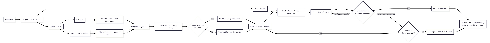

# Approach & Design Document
## Find the First Exact Frame Where the On Screen Dialogue Appears in a Video

---

## Table of Contents

1. [Problem](#problem)
2. [Solution](#solution)
3. [Functional Requirements](#functional-requirements)
4. [Non-Functional Requirements](#non-functional-requirements)
5. [Additional Requirements (Future Scope)](#additional-requirements-future-scope)
6. [Scope of This Document](#scope-of-this-document)
7. [Approaches Considered](#approaches-considered)
8. [Phase-Wise Development Plan & Timeline](#phase-wise-development-plan--timeline)
9. [System Architecture](#system-architecture)
10. [User Flow](#user-flow)
11. [System Flow](#system-flow)
12. [Edge Cases and Handling](#edge-cases-and-handling)
13. [Assumptions](#assumptions)
14. [Customer Impact](#customer-impact)
15. [Novelty and USP](#novelty-and-usp-compared-to-existing-solutions)
16. [Installation, Setup, and Distribution](#installation-setup-and-distribution)
17. [References and Links](#references-and-links)

---

## Problem

Given a public video URL, a specific line of dialogue is spoken at some point by a character who is visibly on camera while saying it. The task is to build a program that identifies the exact frame where that dialogue is first spoken **on-screen** dialogue (a character's face visible in the current shot, mouth movement in sync with the audio, at that moment in time) and returns the timestamp, frame number, the dialogue text, and the frame image itself. "On-screen" specifically excludes voice-over, off-camera narration, and any case where the audio is heard but the speaker is not the person currently in frame.

The solution must work on an arbitrary public video without manual inspection, must tolerate normal variation in resolution, frame rate, and video quality, and must generalize the evaluator may substitute a different video or a different target line entirely, so nothing in the design may be tuned to the one sample clip and phrase provided (`https://ok.ru/video/248244667877`, *"My mind rebels at stagnation"*).

## Solution

The system is a modular pipeline that treats this as three separate sub-problems fused together, rather than one end-to-end model call: **what was said and when** (speech recognition), **who said it** (speaker diarization), and **was the speaker visibly on-camera while saying it** (audio-visual active speaker detection). Each stage is independently verifiable and swappable.

Two modes are supported from one shared pipeline:

- **Mode A — target dialogue provided:** locate the phrase in the transcript, verify on-screen status only for the small time window(s) around it, and return the first verified occurrence with an early exit — the full video is never visually processed.
- **Mode B — no dialogue provided:** every detected speech segment is treated as a candidate, verified the same way, and every confirmed on-screen dialogue is returned as a list.

Final result shape (Mode A):

```json
{
  "status": "success",
  "timestamp": "00:01:42.350",
  "frame_number": 2456,
  "text": "My mind rebels at stagnation",
  "confidence": 0.92,
  "face_detection_confidence": 0.91,
  "image": "frame_2456.png"
}
```

Mode B returns the same object shape, repeated inside a list, plus a separate `ambiguous` bucket for low-confidence detections rather than silently discarding or force-including them.

## Functional Requirements

- Accept a public video URL as input.
- Accept an optional target dialogue string.
- **Mode A:** return the first verified on-screen occurrence — timestamp, frame number, extracted text, confidence, frame image.
- **Mode B:** return every verified on-screen dialogue in the video as a list — timestamp, frame number, text, speaker tag, confidence, frame image.
- Correctly distinguish on-screen dialogue from off-screen dialogue and voice-over/narration.
- Operate without requiring manual inspection of the video by the evaluator.
- Generalize to a different video and/or a different target dialogue supplied at evaluation time.
- Report a clear, structured error when the video, audio, or target dialogue cannot be processed and never crash silently.

## Non-Functional Requirements

- **Robustness** to variation in resolution, frame rate (including variable frame rate sources), and video quality.
- **Efficiency** — avoid full-video visual/CV processing whenever the target phrase narrows the search to small candidate windows (early exit).
- **Graceful degradation** — every stage reports a status and reason rather than an unhandled exception.
- **Explainability** — results carry a confidence value; nothing is a bare true/false with no supporting signal.
- **Reproducibility** — matching and thresholding logic is deterministic and documented, not tuned per video.
- **Modularity** — components (especially active-speaker verification) sit behind a stable interface so one implementation can be swapped for another without touching the rest of the pipeline.
- **Security** — API keys and tokens are never hardcoded or committed to the repository.
- **Right-sized scope** — no infrastructure (job queues, microservices, orchestration) beyond what a single evaluator-run submission actually needs.

## Additional Requirements (Future Scope)

These are deliberately **not implemented** in this submission but listed to show the design space beyond the requirements.

**Robustness**
- Automatic local fallback to a pretrained open-source active-speaker-detection model if the hosted API is unreachable.
- Burned-in subtitle OCR as a secondary cross-check against the ASR transcript on noisy audio.
- Using an official caption/subtitle track, when a platform provides one, as a fast first-pass locator before falling back to full transcription.

**Product / UX**
- Speaker re-identification across the whole video, to answer "every time this specific character speaks on-screen," not just isolated lines.
- User-adjustable detection strictness (exposing the active-speaker confidence threshold).
- Multiple target phrases searched in a single request.
- Exporting Mode B's results as editing-software timeline markers or an SRT-like index.

**Scale**
- Caching transcript, diarization, and alignment output per video hash so re-querying the same video doesn't reprocess it.
- Multi-language support beyond English (the ASR and active-speaker models both support it; thresholds would need per-language tuning).
- Multi-audio-track handling for dubbed videos (currently assumes the default/primary track).

## Scope of This Document

This document explains the system's architecture and the reasoning behind each technology choice, including alternative approaches that were considered and specifically why each was accepted or rejected. It covers how the system decides where to look in a video, how it determines the exact frame, how it extracts the dialogue text, and explicitly, since the brief asks for it how ambiguous or uncertain results are detected and reported rather than guessed at. It also includes the three system diagrams, the edge-case and assumption tables, and setup/installation instructions.

## Approaches Considered

Four approaches were evaluated. One is the recommended design; two are viable fallbacks or alternates; one was surveyed and rejected outright.

### Recommended Approach --> ASR + Diarization + Hosted Active Speaker Detection

**What:** `faster-whisper` for transcription with word-level timestamps, `pyannote-audio` for speaker diarization, a timestamp-overlap alignment step to tag each word with a speaker, fuzzy phrase matching against the aligned transcript (Mode A) or full segment enumeration (Mode B), and NVIDIA's hosted Active Speaker Detection NIM to verify, on a small candidate video window, whether a visible face is actually producing the matched audio.

**Why this:** The problem is not one task but three (what/when, who, and visibly-speaking-or-not), and no single off-the-shelf model reliably does all three at once. Decomposing into independently benchmarked components gives a confidence score at every stage instead of one opaque guess, and each component can be defended and swapped on its own. NVIDIA's model is trained on AVA-ActiveSpeaker — Hollywood movie clips, the same domain as the target video — and the hosted endpoint needs no local GPU, which matters under a tight timeline.

**How:** Ingest and normalize the video (H.264 MP4 + 16kHz mono WAV) -> transcribe and diarize the audio -> align words to speakers by greatest-overlap -> for Mode A, fuzzy-match the target phrase (normalized, tolerant of ASR noise) and take the earliest chronological match; for Mode B, take every segment -> build a small clip around the candidate window -> send it plus a diarization JSON (a simple flat `words: [{text, start, end, speaker_id}]` shape, verified directly against the real client code, not just the documentation) to NVIDIA's Active Speaker Detection service -> read back per-frame `is_speaking` and `face_detection_confidence` per detected face -> take the first frame where the target speaker is confirmed -> map the response's `frame_id` back to the original video (correcting for the candidate clip's start offset) -> extract and save that exact frame.

**Pros:** Precise word-level timestamps; efficient (early exit -- the small candidate window is the only part that ever goes through active-speaker verification); no local GPU required; calibrated confidence available (`face_detection_confidence`) instead of a bare boolean; every part of the input/output contract was verified against the actual proto schema and client source, not assumed from documentation alone; graceful degradation is possible at every stage.

**Cons:** Depends on network access to NVIDIA's endpoint and to the (gated) `pyannote` pretrained pipeline at run time; two external services to keep credentials for; still real integration work even though every component is pretrained.

### Fallback 1 --> Same Pipeline, Local Active Speaker Detection

**What:** Identical pipeline, with the hosted NVIDIA call replaced by a locally-run, pretrained, open-source active-speaker-detection model -- primarily `Light-ASD` (CVPR 2023), with `TalkNet-ASD` as a secondary option.

**Why this:** Removes the network dependency entirely -- used if the hosted endpoint is unreachable, rate-limited, or full offline/on-prem operation is required. Not a hypothetical: both repositories were checked directly (not just referenced by name) and confirmed to ship pretrained weights with a documented single-command inference path on an arbitrary input video, unlike some superficially similar repositories that turned out to require training from scratch.

**How:** Implement the active-speaker step behind a shared interface (e.g. `ASDProvider.detect(clip, diarization) -> results`), with the NVIDIA call as one implementation and a `Light-ASD` wrapper as another, both returning the same result shape so the rest of the pipeline cannot tell which one answered. Use the TalkSet-fine-tuned weights, not the raw AVA-only checkpoint -- the authors' own documentation notes that AVA-only training does not generalize well to footage outside the AVA dataset.

**Pros:** No external network dependency, no API key or quota concerns, verified to actually run rather than assumed.

**Cons:** Heavier local environment (specific PyTorch/face-detector dependencies to install), an older codebase in `TalkNet-ASD`'s case (pins an old Python version), and no built-in face-tracking-across-cuts or re-identification the combined NVIDIA service provides natively.

### Fallback 2 --> Direct Video-Text Embedding Retrieval (Considered, Rejected)

**What:** Pass video clips and the target phrase through a joint video-text embedding model (a CLIP-style dual encoder) or a general multimodal LLM, and retrieve/rank directly by similarity, skipping separate ASR/diarization/ASD stages entirely.

**Why considered:** On paper, a single model call instead of a five-stage pipeline.

**Why rejected:** These models are trained for semantic, scene-level retrieval ("does this clip's content match this sentence's meaning"), not verbatim phrase localization -- a paraphrased or thematically similar scene can rank above the literal correct line. Temporal resolution is clip-level (several seconds), not frame-level. Most importantly, it has no mechanism for the on-screen/off-screen distinction at all: a visible-but-silent face and an audible off-camera voice-over can look visually near-identical to a model that was never trained to check audio-visual sync. Asking a general multimodal model to output a timestamp as free text also has no calibrated confidence behind it, unlike a discriminatively-trained sync model.

**Pros (in principle):** Fewer moving parts, single model call.

**Cons:** Wrong tool for exact-text localization; no sync-verification capability; no reliable, defensible confidence signal.

### Last Fallback Option --> Training an Active Speaker Detector From Scratch (Not suitable)

Academic ASD codebases (e.g. `ASDNet`) exist and implement sound architectures, but on inspection the specific repository ships no pretrained weights for direct inference -- it requires downloading the full AVA-ActiveSpeaker dataset, running a multi-stage preprocessing pipeline producing roughly 124GB of extracted face crops, and training two model stages from scratch. A multi-day undertaking, incompatible with this submission's timeline. Kept in this document to show the design space was surveyed rather than guessed at.

## Phase-Wise Development Plan & Timeline

Built in an order that keeps a demonstrable result available at every stage, rather than integrating everything at once at the end.

| Phase | Deliverable | Target |
|---|---|---|
| 0 | Design doc skeleton (this document, first pass) | Before any code is written prior to day 1 |
| 1 | Ingestion service: URL validation, `yt-dlp` acquisition, `ffprobe` media validation, `ffmpeg` normalization to standard MP4/WAV | Day 1, early |
| 2 | Transcription (`faster-whisper`) + diarization (`pyannote`) + timestamp alignment; output printed and manually verified | Day 1, midday |
| 3 | Fuzzy dialogue matching for Mode A -- target phrase to candidate timestamp, no computer vision involved yet | Day 1, afternoon |
| 4 | NVIDIA Active Speaker Detection integration -- verified first against NVIDIA's own sample video/audio/diarization assets, then against generated output | Day 1 evening into Day 2 morning |
| 5 | First valid frame selection, frame extraction, final JSON result -- **Mode A complete: the core deliverable** | Day 2, morning |
| 6 | Mode B -- full-video segment enumeration and aggregation, ambiguous-result bucket | Day 2, midday |
| 7 | Edge-case and failure-path hardening: retries, structured errors at every stage, local-file fallback for ingestion failures | Day 2, afternoon |
| 8 | Unit + integration tests, Dockerfile, README, finalize this document and the prompts log, submit | Day 2, evening, ahead of the deadline |

## System Architecture


## User Flow


## System Flow



## Edge Cases and Handling

### Detection and dialogue

| Case | Handling |
|---|---|
| Same dialogue appears more than once (flashback/callback) | Return the first occurrence that is verified on-screen, not just the first transcript match |
| Speaker enters the frame after the dialogue starts | Return the first frame where "dialogue in progress" AND "speaker visible and speaking" are both true |
| Dialogue starts before a camera cut | Return the first frame after the cut where the speaker is actively speaking |
| ASR mishears a word in the target phrase | Normalize and fuzzy-match; never require exact string equality |
| Dialogue spans multiple transcription chunks | Maintain overlap/context across chunk boundaries so matching isn't broken at a chunk edge |
| A line is split across a cut mid-sentence | Check sync per sub-segment, not the whole utterance, or a partial match mislabels the whole line |
| Multiple people visible, one speaking | Active speaker detection identifies which visible face is the one speaking |
| Multiple people speaking simultaneously | Valid on-screen dialogue by definition; if confidence is insufficient to disambiguate, mark ambiguous rather than guess |
| Mirror reflection, in-scene video call, or broadcast | Handled automatically -- detection only checks whether a visible mouth explains the audio, not which surface it's reflected off |
| Voice-over / internal monologue | No visibly active speaker for that audio -> classified as not on-screen |
| Low-quality, blurry, or dark footage | Check neighboring frames / temporal smoothing before giving up; mark ambiguous if still uncertain |
| No face visible for the entire dialogue | Report `"status": "not_on_screen"` with a reason, not a false positive |

### Input and infrastructure

| Case | Handling |
|---|---|
| Download fails (site change, geo-restriction, DRM, CAPTCHA, expired link) | Retry with backoff, then return a clear ingestion error; accept a local file path as a manual fallback |
| Mixed source formats, codecs, resolutions, audio layouts | Normalize every input to H.264 MP4 + mono 16kHz WAV before any further processing |
| Variable frame rate source | Read the actual decoded fps after normalization; never assume a fixed value (24/25/30) |
| File-size / codec limit on the active-speaker-detection input | Check size after normalization; downscale or chunk long files for Mode B, adding each chunk's time offset back to results |
| Trimmed-clip frame offset | The returned frame index is relative to the sent clip, not the source file -- add back the clip's start-frame offset |
| Diarization JSON unit mismatch (seconds vs. milliseconds) | Confirmed against the exact parser in use before relying on it; unit tested directly |
| No audio track, or corrupted media | Fail during ingestion validation with a clear, specific error, before any downstream stage runs |
| Any stage failure (ASR, diarization, API auth, network) | Return a structured status and reason for that stage; never an unhandled crash |

## Assumptions

| Assumption | Reasoning |
|---|---|
| A single video URL is processed per request, not a live stream | Scope boundary for this submission |
| The video is publicly accessible and legally processable | Stated precondition; not independently verified by the system |
| The video contains an audio track | Required by every speech-based stage |
| Audio and video in the source file are reasonably in sync | Ingestion does not attempt to correct pre-existing desync |
| "First frame the dialogue appears" means the frame nearest the onset of the first matched word | The objective, reproducible reading of an otherwise ambiguous phrase |
| Only the primary/default audio track is used | No multi-dub-track selection in this submission |
| English is the default working language | Not threshold-tuned per language for this submission |
| No model in the pipeline is trained from scratch | Deliberate, time-driven choice -- every component used is pretrained |
| Detection uses a calibrated confidence threshold, not a claim of perfect accuracy | No ASR or active-speaker model is 100% accurate; uncertainty is reported, not hidden |
| A UI is optional | The brief requires the specified outputs, not a frontend |
| Diarization output is a required input to the active-speaker-detection step | Confirmed against the actual service's input contract -- not optional scaffolding |
| The active-speaker-detection endpoint requires internet access at evaluation time | A real, stated dependency rather than an assumed-away one |
| If the local fallback model is used, the dataset-diverse fine-tuned weights are used, not the AVA-only checkpoint | AVA-only training does not generalize well to footage outside the AVA dataset |

## Customer Impact

Converts an unstructured video into searchable, speaker-aware, visually-verified information -- not just "this sentence exists in the audio," but confirmation that the person saying it is visible and actively speaking, plus the exact frame where that happens.

- **Film / media production** -- instantly locate the shot where a specific line was delivered on camera.
- **Podcasts and interviews** -- find the moment a guest speaks on camera, not just when they're mentioned.
- **Journalism** -- locate visually verifiable, on-camera statements rather than relying on audio alone.
- **Education** -- search lecture recordings for moments the instructor is visibly speaking.
- **Content editing** -- automatically pull every on-screen clip of a given line or speaker.
- **Video search generally** -- search not just what was said, but where the person saying it is actually shown.

## Novelty and USP Compared to Existing Solutions

| Existing approach | Limitation |
|---|---|
| Manual scrubbing through the video | Exactly what this problem statement asks to avoid |
| Caption/transcript search (YouTube search, Descript, broadcast archive tools) | Finds where the *text* occurs, with no concept of on-screen vs. off-screen -- a voice-over recap and the real on-camera delivery look identical to it |
| Academic active-speaker-detection models used standalone | Solve the sync-verification half well, but as a research component fed a pre-cropped face, not an end-to-end "URL + quote to frame" system |

What this solution does differently:

- Enforces the on-screen/off-screen distinction the brief is built around, rather than stopping at a text match.
- Localizes before it verifies -- small candidate windows checked in order, not the entire video processed regardless of need.
- Reports a confidence score and an explicit ambiguous state, instead of a bare yes/no.
- Every external component and data contract used here (API schemas, model training data, whether pretrained weights actually ship) was independently verified against source code and documentation during development, not assumed from a repository's name or description.

## Installation, Setup, and Distribution

**Prerequisites:** Python 3.10+, `ffmpeg`/`ffprobe` on the system path, an NVIDIA Build API key, a Hugging Face access token (for the `pyannote` pretrained pipeline).

**Setup:**

```bash
git clone <this-repository-url>
cd <repository-folder>
python -m venv venv && source venv/bin/activate
pip install -r requirements.txt
cp .env.example .env   # fill in NGC_API_KEY and HF_TOKEN
```

**Run:**

```bash
python main.py --url "https://ok.ru/video/248244667877" \
                --dialogue "My mind rebels at stagnation"
# or, for discovery mode:
python main.py --url "https://ok.ru/video/248244667877"
```

Results (JSON) and extracted frame images are written to the `output/` directory.

**Distribution:** a `Dockerfile` will be  provided so the evaluator does not need to install `ffmpeg`, GPU-adjacent Python packages, or a gRPC client locally -- `docker build` and `docker run` with the two credentials as environment variables reproduces the exact environment this was built and tested in. API keys are never committed; only `.env.example` with placeholder values is checked in.

## References and Links

- NVIDIA Active Speaker Detection -- model card & try-it: https://build.nvidia.com/nvidia/active-speaker-detection
- NVIDIA Active Speaker Detection -- NIM documentation: https://docs.nvidia.com/nim/maxine/active-speaker-detection/latest/index.html
- NVIDIA Maxine NIM client code (gRPC client, proto schema, diarization parsers): https://github.com/NVIDIA-Maxine/nim-clients
- faster-whisper: https://github.com/SYSTRAN/faster-whisper
- pyannote-audio: https://github.com/pyannote/pyannote-audio
- yt-dlp: https://github.com/yt-dlp/yt-dlp
- Light-ASD (local fallback, verified pretrained + runnable): https://github.com/Junhua-Liao/Light-ASD
- TalkNet-ASD (secondary local fallback): https://github.com/TaoRuijie/TalkNet-ASD
- ASDNet (surveyed, rejected -- no shipped pretrained weights): https://github.com/okankop/ASDNet
