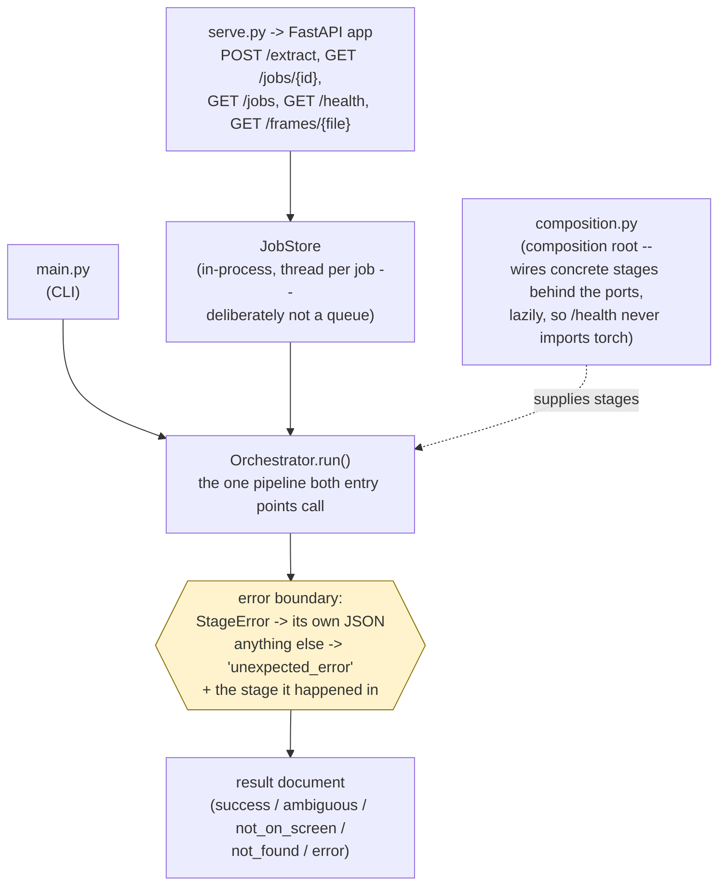
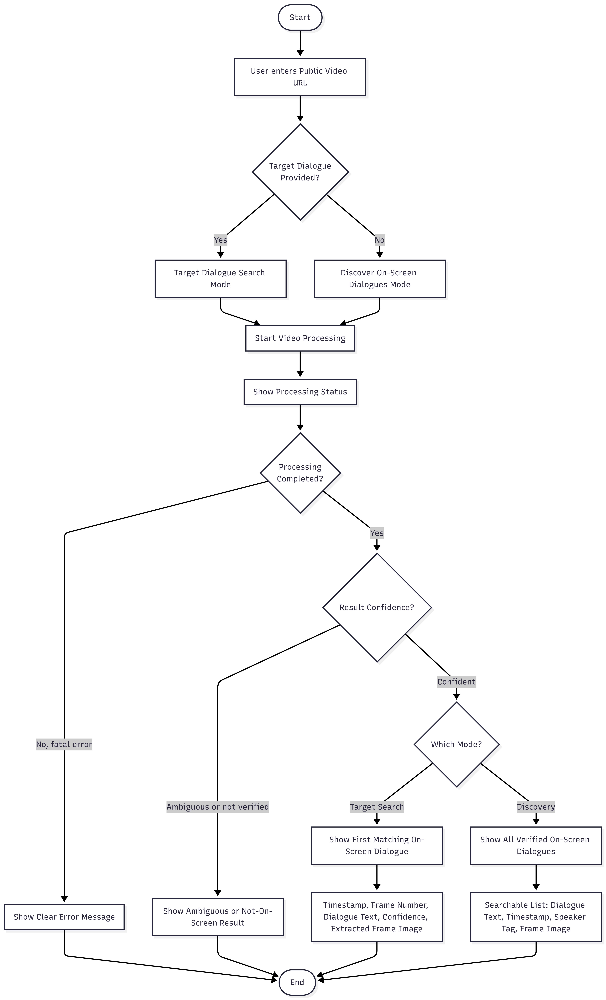

# Approach & Design Document
## Find the First Exact Frame Where the On Screen Dialogue Appears in a Video

---

## Table of Contents

1. [Problem](#problem)
2. [Solution](#solution)
3. [Functional Requirements](#functional-requirements)
4. [Non-Functional Requirements](#non-functional-requirements)
5. [Additional Requirements (Future Scope)](#additional-requirements-future-scope)
6. [Scope of This Document](#scope-of-this-document)
7. [Approaches Considered](#approaches-considered)
8. [Phase-Wise Development Plan & Timeline](#phase-wise-development-plan--timeline)
9. [System Architecture](#system-architecture)
10. [User Flow](#user-flow)
11. [System Flow](#system-flow)
12. [Edge Cases and Handling](#edge-cases-and-handling)
13. [Assumptions](#assumptions)
14. [Customer Impact](#customer-impact)
15. [Novelty and USP](#novelty-and-usp-compared-to-existing-solutions)
16. [Installation, Setup, and Distribution](#installation-setup-and-distribution)
17. [Implementation Notes: What the Plan Didn't Know Yet](#implementation-notes-what-the-plan-didnt-know-yet)
18. [References and Links](#references-and-links)

---

## Problem

Given a public video URL, a specific line of dialogue is spoken at some point by a character who is visibly on camera while saying it. The task is to build a program that identifies the exact frame where that dialogue is first spoken **on-screen** dialogue (a character's face visible in the current shot, mouth movement in sync with the audio, at that moment in time) and returns the timestamp, frame number, the dialogue text, and the frame image itself. "On-screen" specifically excludes voice-over, off-camera narration, and any case where the audio is heard but the speaker is not the person currently in frame.

The solution must work on an arbitrary public video without manual inspection, must tolerate normal variation in resolution, frame rate, and video quality, and must generalize the evaluator may substitute a different video or a different target line entirely, so nothing in the design may be tuned to the one sample clip and phrase provided (`https://ok.ru/video/248244667877`, *"My mind rebels at stagnation"*).

## Solution

The system is a modular pipeline that treats this as three separate sub-problems fused together, rather than one end-to-end model call: **what was said and when** (speech recognition), **who said it** (speaker diarization), and **was the speaker visibly on-camera while saying it** (audio-visual active speaker detection). Each stage is independently verifiable and swappable.

Two modes are supported from one shared pipeline:

- **Mode A — target dialogue provided:** locate the phrase in the transcript, verify on-screen status only for the small time window(s) around it, and return the first verified occurrence with an early exit — the full video is never visually processed.
- **Mode B — no dialogue provided:** every detected speech segment is treated as a candidate, verified the same way, and every confirmed on-screen dialogue is returned as a list.

Final result shape (Mode A):

```json
{
  "status": "success",
  "timestamp": "00:01:42.350",
  "frame_number": 2456,
  "text": "My mind rebels at stagnation",
  "confidence": 0.92,
  "face_detection_confidence": 0.91,
  "image": "frame_2456.png"
}
```

Mode B returns the same object shape, repeated inside a list, plus a separate `ambiguous` bucket for low-confidence detections rather than silently discarding or force-including them.

## Functional Requirements

- Accept a public video URL as input.
- Accept an optional target dialogue string.
- **Mode A:** return the first verified on-screen occurrence — timestamp, frame number, extracted text, confidence, frame image.
- **Mode B:** return every verified on-screen dialogue in the video as a list — timestamp, frame number, text, speaker tag, confidence, frame image.
- Correctly distinguish on-screen dialogue from off-screen dialogue and voice-over/narration.
- Operate without requiring manual inspection of the video by the evaluator.
- Generalize to a different video and/or a different target dialogue supplied at evaluation time.
- Report a clear, structured error when the video, audio, or target dialogue cannot be processed and never crash silently.

## Non-Functional Requirements

- **Robustness** to variation in resolution, frame rate (including variable frame rate sources), and video quality.
- **Efficiency** — avoid full-video visual/CV processing whenever the target phrase narrows the search to small candidate windows (early exit).
- **Graceful degradation** — every stage reports a status and reason rather than an unhandled exception.
- **Explainability** — results carry a confidence value; nothing is a bare true/false with no supporting signal.
- **Reproducibility** — matching and thresholding logic is deterministic and documented, not tuned per video.
- **Modularity** — components (especially active-speaker verification) sit behind a stable interface so one implementation can be swapped for another without touching the rest of the pipeline.
- **Security** — API keys and tokens are never hardcoded or committed to the repository.
- **Right-sized scope** — no infrastructure (job queues, microservices, orchestration) beyond what a single evaluator-run submission actually needs.

## Additional Requirements (Future Scope)

These are deliberately **not implemented** in this submission but listed to show the design space beyond the requirements.

**Robustness**
- Automatic local fallback to a pretrained open-source active-speaker-detection model if the hosted API is unreachable.
- Burned-in subtitle OCR as a secondary cross-check against the ASR transcript on noisy audio.
- Using an official caption/subtitle track, when a platform provides one, as a fast first-pass locator before falling back to full transcription.

**Product / UX**
- Speaker re-identification across the whole video, to answer "every time this specific character speaks on-screen," not just isolated lines.
- User-adjustable detection strictness (exposing the active-speaker confidence threshold).
- Multiple target phrases searched in a single request.
- Exporting Mode B's results as editing-software timeline markers or an SRT-like index.

**Scale**
- Multi-language support beyond English (the ASR and active-speaker models both support it; thresholds would need per-language tuning).
- Multi-audio-track handling for dubbed videos (currently assumes the default/primary track).

> Content-addressed disk caching of the transcript and diarization output, keyed
> by audio hash plus a fingerprint of every setting that changes the result
> (model, quantization, pipeline version), was originally listed here as future
> scope. It was pulled forward into Phase 2 instead: without it, every code
> change to a later stage meant re-transcribing and re-diarizing the whole video
> before reaching the line being worked on. See
> [Implementation Notes](#implementation-notes-what-the-plan-didnt-know-yet).

## Scope of This Document

This document explains the system's architecture and the reasoning behind each technology choice, including alternative approaches that were considered and specifically why each was accepted or rejected. It covers how the system decides where to look in a video, how it determines the exact frame, how it extracts the dialogue text, and explicitly, since the brief asks for it how ambiguous or uncertain results are detected and reported rather than guessed at. It also includes the three system diagrams, the edge-case and assumption tables, and setup/installation instructions.

## Approaches Considered

Four approaches were evaluated. One is the recommended design; two are viable fallbacks or alternates; one was surveyed and rejected outright.

### Recommended Approach --> ASR + Diarization + Hosted Active Speaker Detection

**What:** `faster-whisper` for transcription with word-level timestamps, `pyannote-audio` for speaker diarization, a timestamp-overlap alignment step to tag each word with a speaker, fuzzy phrase matching against the aligned transcript (Mode A) or full segment enumeration (Mode B), and NVIDIA's hosted Active Speaker Detection NIM to verify, on a small candidate video window, whether a visible face is actually producing the matched audio.

**Why this:** The problem is not one task but three (what/when, who, and visibly-speaking-or-not), and no single off-the-shelf model reliably does all three at once. Decomposing into independently benchmarked components gives a confidence score at every stage instead of one opaque guess, and each component can be defended and swapped on its own. NVIDIA's model is trained on AVA-ActiveSpeaker — Hollywood movie clips, the same domain as the target video — and the hosted endpoint needs no local GPU, which matters under a tight timeline.

**How:** Ingest and normalize the video (H.264 MP4 + 16kHz mono WAV) -> transcribe and diarize the audio -> align words to speakers by greatest-overlap -> for Mode A, fuzzy-match the target phrase (normalized, tolerant of ASR noise) and take the earliest chronological match; for Mode B, take every segment -> build a small clip around the candidate window -> send it plus a diarization JSON (a simple flat `words: [{text, start, end, speaker_id}]` shape, verified directly against the real client code, not just the documentation) to NVIDIA's Active Speaker Detection service -> read back per-frame `is_speaking` and `face_detection_confidence` per detected face -> take the first frame where the target speaker is confirmed -> map the response's `frame_id` back to the original video (correcting for the candidate clip's start offset) -> extract and save that exact frame.

**Pros:** Precise word-level timestamps; efficient (early exit -- the small candidate window is the only part that ever goes through active-speaker verification); active-speaker verification itself needs no local GPU, since it runs on a hosted endpoint; calibrated confidence available (`face_detection_confidence`) instead of a bare boolean; every part of the input/output contract was verified against the actual proto schema and client source, not assumed from documentation alone; graceful degradation is possible at every stage.

*Correction after implementation:* "no local GPU required" originally described the whole pipeline, which overstated it. Transcription and diarization run locally and are markedly faster with one -- CUDA is auto-detected and used when present, with a CPU fallback -- so a GPU is optional for the pipeline as a whole and specifically unnecessary only for the active-speaker step.

**Cons:** Depends on network access to NVIDIA's endpoint and to the (gated) `pyannote` pretrained pipeline at run time; two external services to keep credentials for; still real integration work even though every component is pretrained.

### Fallback 1 --> Same Pipeline, Local Active Speaker Detection

**What:** Identical pipeline, with the hosted NVIDIA call replaced by a locally-run, pretrained, open-source active-speaker-detection model -- primarily `Light-ASD` (CVPR 2023), with `TalkNet-ASD` as a secondary option.

**Why this:** Removes the network dependency entirely -- used if the hosted endpoint is unreachable, rate-limited, or full offline/on-prem operation is required. Not a hypothetical: both repositories were checked directly (not just referenced by name) and confirmed to ship pretrained weights with a documented single-command inference path on an arbitrary input video, unlike some superficially similar repositories that turned out to require training from scratch.

**How:** Implement the active-speaker step behind a shared interface (e.g. `ASDProvider.detect(clip, diarization) -> results`), with the NVIDIA call as one implementation and a `Light-ASD` wrapper as another, both returning the same result shape so the rest of the pipeline cannot tell which one answered. Use the TalkSet-fine-tuned weights, not the raw AVA-only checkpoint -- the authors' own documentation notes that AVA-only training does not generalize well to footage outside the AVA dataset.

**Pros:** No external network dependency, no API key or quota concerns, verified to actually run rather than assumed.

**Cons:** Heavier local environment (specific PyTorch/face-detector dependencies to install), an older codebase in `TalkNet-ASD`'s case (pins an old Python version), and no built-in face-tracking-across-cuts or re-identification the combined NVIDIA service provides natively.

### Fallback 2 --> Direct Video-Text Embedding Retrieval (Considered, Rejected)

**What:** Pass video clips and the target phrase through a joint video-text embedding model (a CLIP-style dual encoder) or a general multimodal LLM, and retrieve/rank directly by similarity, skipping separate ASR/diarization/ASD stages entirely.

**Why considered:** On paper, a single model call instead of a five-stage pipeline.

**Why rejected:** These models are trained for semantic, scene-level retrieval ("does this clip's content match this sentence's meaning"), not verbatim phrase localization -- a paraphrased or thematically similar scene can rank above the literal correct line. Temporal resolution is clip-level (several seconds), not frame-level. Most importantly, it has no mechanism for the on-screen/off-screen distinction at all: a visible-but-silent face and an audible off-camera voice-over can look visually near-identical to a model that was never trained to check audio-visual sync. Asking a general multimodal model to output a timestamp as free text also has no calibrated confidence behind it, unlike a discriminatively-trained sync model.

**Pros (in principle):** Fewer moving parts, single model call.

**Cons:** Wrong tool for exact-text localization; no sync-verification capability; no reliable, defensible confidence signal.

### Last Fallback Option --> Training an Active Speaker Detector From Scratch (Not suitable)

Academic ASD codebases (e.g. `ASDNet`) exist and implement sound architectures, but on inspection the specific repository ships no pretrained weights for direct inference -- it requires downloading the full AVA-ActiveSpeaker dataset, running a multi-stage preprocessing pipeline producing roughly 124GB of extracted face crops, and training two model stages from scratch. A multi-day undertaking, incompatible with this submission's timeline. Kept in this document to show the design space was surveyed rather than guessed at.

## Phase-Wise Development Plan & Timeline

Built in an order that keeps a demonstrable result available at every stage, rather than integrating everything at once at the end.

| Phase | Deliverable | Gate before the next phase started |
|---|---|---|
| 0 | Design doc (this document) plus the full package skeleton, frozen data contracts, and SOLID port definitions -- no behaviour yet | Plan reviewed and corrected before any implementation code was written |
| 1 | Ingestion: URL validation, `yt-dlp` acquisition, `ffprobe` media validation, `ffmpeg` normalization to forced-CFR MP4/WAV | Manually run against a real download and inspected |
| 2 | Transcription (`faster-whisper`) with deterministic decoding, disk-cached by audio hash | Manually run and word-level output inspected |
| 3 | Diarization (`pyannote-audio` v4) + greatest-overlap alignment + the diarization JSON serializer | Manually run and speaker attribution inspected |
| 4 | Fuzzy dialogue matching and candidate-window construction for Mode A -- no computer vision involved yet | Manually run offline against the transcript |
| 5 | NVIDIA Active Speaker Detection integration, adapted from the vendored client code | Verified against NVIDIA's own sample assets before being pointed at this pipeline's own output |
| 6 | Frame selection (duration-derived smoothing, speaker cross-check, scene-cut awareness), frame extraction, confidence scoring -- **Mode A complete** | Run against the real target video; extracted frame opened and confirmed on camera |
| 7 | Mode B -- full-video candidate enumeration, budgets, the `ambiguous` and `not_on_screen` buckets | Run to completion on the real video; every off-screen candidate individually reviewed against the film |
| 8 | Orchestrator with a total error boundary, `main.py` composition root, FastAPI job-polling API, Dockerfile | End-to-end CLI and API runs against the real video; Docker image built and its non-root/ffmpeg setup verified |
| 9 | This document, the README, and the prompts log brought in line with what was actually built | Full suite green; this table itself corrected against phase 9's own findings |

Each phase gate was a manual verification step the developer performed before
the next phase began, not merely tests passing -- kept as a deliberate choice
over the single continuous build the original two-day estimate assumed, because
catching a wrong assumption (see the next section) after one phase costs far
less than catching it after eight.

## System Architecture


> This diagram was drawn in Phase 0, before any code existed, and its top box
> reads "Web UI / REST API" as one unit. Both halves now exist: a React frontend
> in `frontend/`, served by the same FastAPI process that exposes the API, plus
> the CLI (`main.py`). All three surfaces drive one orchestrator underneath.
> That orchestrator layer -- and the error boundary, job store, and composition
> root around it -- did not exist as a concept when this diagram was drawn, so it
> is shown separately below rather than redrawn into a diagram that otherwise
> still reflects the pipeline stages accurately.

**What actually sits behind both entry points:**



The API layer answers `POST /extract` in milliseconds with a job id and runs the
pipeline on a background thread, because a real run takes minutes and cannot
answer inside one HTTP request. `GET /jobs/{id}` is then polled for progress and
the final result -- a correct `not_on_screen` or `not_found` answer is still a
`200`, never a `404`, since the job succeeded even though the answer is "no."

## User Flow



> Drawn before either interface existed, so "Show Processing Status" and "Show
> Clear Error Message" describe the logical flow rather than a specific screen.
> In the built system that is stdout for the CLI and the polled JSON body for
> the API; both surface the same status values this diagram already lays out.

## System Flow


> This one held up well against the real implementation. Two things it
> necessarily omits at this level of abstraction, both covered in
> [Implementation Notes](#implementation-notes-what-the-plan-didnt-know-yet):
> "Candidate Time Window" is padded up to a measured ~3.5s floor before being
> sent for detection, and "Another Occurrence Left?" in Mode B is budgeted
> (`--max-candidates` / `--time-budget`) with the sweep reporting `truncated`
> honestly when a budget stops it early.

## Edge Cases and Handling

### Detection and dialogue

| Case | Handling |
|---|---|
| Same dialogue appears more than once (flashback/callback) | Return the first occurrence that is verified on-screen, not just the first transcript match |
| Speaker enters the frame after the dialogue starts | Return the first frame where "dialogue in progress" AND "speaker visible and speaking" are both true |
| Dialogue starts before a camera cut | Return the first frame after the cut where the speaker is actively speaking |
| ASR mishears a word in the target phrase | Normalize and fuzzy-match; never require exact string equality |
| Dialogue spans multiple transcription chunks | Maintain overlap/context across chunk boundaries so matching isn't broken at a chunk edge |
| A line is split across a cut mid-sentence | Check sync per sub-segment, not the whole utterance, or a partial match mislabels the whole line |
| Multiple people visible, one speaking | Active speaker detection identifies which visible face is the one speaking |
| Multiple people speaking simultaneously | Valid on-screen dialogue by definition; if confidence is insufficient to disambiguate, mark ambiguous rather than guess |
| Mirror reflection, in-scene video call, or broadcast | Handled automatically -- detection only checks whether a visible mouth explains the audio, not which surface it's reflected off |
| Voice-over / internal monologue | No visibly active speaker for that audio -> classified as not on-screen |
| Low-quality, blurry, or dark footage | Check neighboring frames / temporal smoothing before giving up; mark ambiguous if still uncertain |
| No face visible for the entire dialogue | Report `"status": "not_on_screen"` with a reason, not a false positive |
| A whole detection *session* returns no speaker association at all | Distinguished from one legitimately off-camera window: raised as `DiarizationDroppedError` only when every window in a run of 3+ shows it, since a single such window is the ordinary off-camera signal, not a fault |
| Candidate window shorter than the detection service can usefully process | Padded up to a measured floor (see Implementation Notes) rather than sent as-is or dropped -- a short line like "Yes." is still real dialogue worth checking |
| A single speaker-less word ("Got", "Now,") between two turns from the same speaker | Absorbed into the neighbouring turn only when the gap between them is zero; a real pause keeps it a separate, correctly-flagged candidate |
| Face count in frame exceeds the detection service's per-frame cap | Reported as `ambiguous` with reason `max_speakers_reached` naming the limitation, not silently dropped or averaged over |

### Input and infrastructure

| Case | Handling |
|---|---|
| Download fails (site change, geo-restriction, DRM, CAPTCHA, expired link) | Retry with backoff, then return a clear ingestion error; accept a local file path as a manual fallback |
| Mixed source formats, codecs, resolutions, audio layouts | Normalize every input to H.264 MP4 + mono 16kHz WAV before any further processing |
| Variable frame rate source | Read the actual decoded fps after normalization; never assume a fixed value (24/25/30) |
| File-size / codec limit on the active-speaker-detection input | Check size after normalization; downscale or chunk long files for Mode B, adding each chunk's time offset back to results |
| Trimmed-clip frame offset | The returned frame index is relative to the sent clip, not the source file -- add back the clip's start-frame offset |
| Diarization JSON unit mismatch (seconds vs. milliseconds) | Confirmed against the exact parser in use before relying on it; unit tested directly |
| No audio track, or corrupted media | Fail during ingestion validation with a clear, specific error, before any downstream stage runs |
| Any stage failure (ASR, diarization, API auth, network) | Return a structured status and reason for that stage; never an unhandled crash |
| An unforeseen failure the design never anticipated (a raw `KeyError`, a dependency's internal exception) | Also caught, not just `StageError` -- the orchestrator's boundary catches `Exception`, names the stage that was running and the exception type, and never lets the raw traceback (with its absolute paths and a misbehaving library's arguments) reach the caller |
| Non-streamable MP4 sent to the detection service | `-movflags +faststart` applied at both normalization and clip-building; verified by inspecting atom order, not just trusting the flag |
| Diarization payload arrives after the first video chunk in a streaming request | Sent first, deliberately, before the first video chunk -- arriving late does not error, it silently produces confident wrong answers |

## Assumptions

| Assumption | Reasoning |
|---|---|
| A single video URL is processed per request, not a live stream | Scope boundary for this submission |
| The video is publicly accessible and legally processable | Stated precondition; not independently verified by the system |
| The video contains an audio track | Required by every speech-based stage |
| Audio and video in the source file are reasonably in sync | Ingestion does not attempt to correct pre-existing desync |
| "First frame the dialogue appears" means the frame nearest the onset of the first matched word | The objective, reproducible reading of an otherwise ambiguous phrase |
| Only the primary/default audio track is used | No multi-dub-track selection in this submission |
| English is the default working language | Not threshold-tuned per language for this submission |
| No model in the pipeline is trained from scratch | Deliberate, time-driven choice -- every component used is pretrained |
| Detection uses a calibrated confidence threshold, not a claim of perfect accuracy | No ASR or active-speaker model is 100% accurate; uncertainty is reported, not hidden |
| A UI is optional, and was built anyway | The brief requires the specified outputs, not a frontend. One exists because the outputs are visual -- a frame image, a confidence breakdown, and a set of lines ruled off camera are all easier to judge on screen than in a terminal -- but nothing in the pipeline depends on it, and the CLI remains a complete interface on its own |
| Diarization output is a required input to the active-speaker-detection step | Confirmed against the actual service's input contract -- not optional scaffolding |
| The active-speaker-detection endpoint requires internet access at evaluation time | A real, stated dependency rather than an assumed-away one |
| If the local fallback model is used, the dataset-diverse fine-tuned weights are used, not the AVA-only checkpoint | AVA-only training does not generalize well to footage outside the AVA dataset |
| Every source video is normalized to a forced constant frame rate before any timing math happens | `frame_number = round(timestamp * fps)` is only exact by construction on CFR; on the source's original (possibly variable) rate it would not be invertible |
| The active-speaker service's per-frame `diarized_speaker_id` of `-1` means "tracked, no speaker match" and is distinct from `0`, a real speaker | Confirmed empirically against the live wire format, not assumed from the (string-typed) documented schema, which does not name a sentinel at all |
| The active-speaker service needs a minimum amount of footage to return anything | Measured directly rather than documented: clips under ~3.5s consistently returned zero frames on the sample video; short candidates are padded up to that floor rather than dropped |
| `NV_AI4M_ASD_MAX_SPEAKERS` limiting detection to 5 simultaneous faces is a server-side default | Sourced from NVIDIA's deployment docs, not the client repository, so it cannot be independently cross-verified from source the way the rest of the contract was; treated as documented-but-unconfirmed and surfaced to the caller as an `ambiguous` reason rather than silently trusted |

## Customer Impact

Converts an unstructured video into searchable, speaker-aware, visually-verified information -- not just "this sentence exists in the audio," but confirmation that the person saying it is visible and actively speaking, plus the exact frame where that happens.

- **Film / media production** -- instantly locate the shot where a specific line was delivered on camera.
- **Podcasts and interviews** -- find the moment a guest speaks on camera, not just when they're mentioned.
- **Journalism** -- locate visually verifiable, on-camera statements rather than relying on audio alone.
- **Education** -- search lecture recordings for moments the instructor is visibly speaking.
- **Content editing** -- automatically pull every on-screen clip of a given line or speaker.
- **Video search generally** -- search not just what was said, but where the person saying it is actually shown.

## Novelty and USP Compared to Existing Solutions

| Existing approach | Limitation |
|---|---|
| Manual scrubbing through the video | Exactly what this problem statement asks to avoid |
| Caption/transcript search (YouTube search, Descript, broadcast archive tools) | Finds where the *text* occurs, with no concept of on-screen vs. off-screen -- a voice-over recap and the real on-camera delivery look identical to it |
| Academic active-speaker-detection models used standalone | Solve the sync-verification half well, but as a research component fed a pre-cropped face, not an end-to-end "URL + quote to frame" system |

What this solution does differently:

- Enforces the on-screen/off-screen distinction the brief is built around, rather than stopping at a text match.
- Localizes before it verifies -- small candidate windows checked in order, not the entire video processed regardless of need.
- Reports a confidence score and an explicit ambiguous state, instead of a bare yes/no.
- Every external component and data contract used here (API schemas, model training data, whether pretrained weights actually ship) was independently verified against source code and documentation during development, not assumed from a repository's name or description.

## Installation, Setup, and Distribution

**Prerequisites:** Python 3.11 (pinned -- `av` and the rest of the requirements
lockfile were verified against it specifically), a current `ffmpeg`/`ffprobe`
build on the system path (Debian/Ubuntu's default package is old enough to
silently fail on modern codecs; see Implementation Notes), an NVIDIA Build API
key plus the Active Speaker Detection function id, and a Hugging Face access
token with the gated `pyannote` pipeline's terms accepted.

**Setup and run:** the full, current commands -- installation, both CLI modes,
every environment variable, the FastAPI server, and Docker -- are kept in
[`README.md`](../README.md) rather than duplicated here, so there is exactly
one place that can go stale. This section stays limited to what does not
change run to run: results (JSON) and extracted frame images are written to
`output/`; API keys are never committed, only `.env.example` with placeholder
values is checked in; and a multi-stage `Dockerfile` is provided precisely so
the evaluator does not need `ffmpeg`, GPU-adjacent Python packages, or a gRPC
client installed locally to reproduce the environment this was built against.

## Implementation Notes: What the Plan Didn't Know Yet

Every row below was found by running the real system against real data, not by
re-reading documentation more carefully. Several directly contradicted what the
plan assumed going in; each is called out because a future maintainer trusting
the original assumption would reproduce the same mistake.

### The contracts the plan left unspecified

| # | What the plan didn't say | What building it revealed |
|---|---|---|
| 1 | *How* to read back per-frame results from the detection service | Already solved upstream: the vendored client's `process_responses()` builds exactly the `{diarized_speaker_id, face_id, is_speaking, face_detection_confidence, bbox}` structure needed, one call before it writes an annotated video nobody asked for. Adaptation, not construction. |
| 2 | The diarization JSON's exact field names and units | `{"words": [{"text", "start", "end", "speaker_id"}]}`, with `start`/`end` in **seconds** -- confirmed against the parser actually used, not the RIVA-flavoured alternative that uses milliseconds and `speakerTag` |
| 3 | The ASD response schema | Per frame: `frame_id`, `speaker_data[]` of `{speaker_bbox, diarized_speaker_id, face_id, is_speaking, face_detection_confidence}` |

### Corrections to stated design decisions

| # | The plan said | What was actually built, and why |
|---|---|---|
| 4 | Read the actual fps and it'll be fine | Reading fps is necessary but not sufficient. On a variable-frame-rate source, `frame_number = round(t * fps)` still isn't invertible. Every source is normalized to a **forced constant frame rate** first, and the manifest records `cfr_forced: true` so the invariant holds by construction, not by hope. |
| 5 | Temporal smoothing over a few consecutive frames | A **fixed** frame count is quietly rate-dependent: 3 frames is 125ms at 24fps but only 50ms at 60fps, silently changing the rule's strictness on exactly the footage it's meant to handle consistently. Smoothing is defined in milliseconds (`MIN_SPEAKING_MS = 120`) and converted per clip: `k_frames = max(1, round(MIN_SPEAKING_MS / 1000 * fps))`. |
| 7 | Confidence is emitted for explainability | Left undefined, "explainable" means nothing. Confidence is a fixed weighted sum -- `match 0.40, asr 0.25, face 0.25, stability 0.10` -- with per-term values disclosed in the result. Mode B has no target phrase, so `match` cannot be scored; the term is **omitted and the remaining weights renormalize to 1.0**, rather than being credited a free 0.40 for something never verified. |
| 8 | Enumerate every segment for discovery mode | Untenable at scale -- roughly 1,200 network round-trips on a 90-minute film. Mode B takes `--max-candidates` / `--time-budget`, and a sweep a budget stops early reports `truncated: true` with honest processed/total counts rather than presenting a partial list as if it were exhaustive. |
| 9 | One file-size limit | Two genuinely distinct limits exist and were being conflated: the try-it page's documented 500MB/H.264 input cap, and an unpublished per-request duration limit on the hosted function itself. Kept separate; clips are capped at a conservative default and a `RESOURCE_EXHAUSTED` response is handled by halving the window and retrying once. |
| 10 | (implicit) Whisper's defaults are fine | Sampling temperature and prior-text conditioning are non-deterministic by default -- a "reproducible" NFR that silently wasn't. Pinned to `temperature=0.0`, `condition_on_previous_text=False`, a fixed beam size, and `compute_type` folded into the cache key, since quantization alone moved the transcript by more than a dozen words on the sample video. |
| 11 | `pyannote` pipeline (unnamed version) | The v3 pipeline id and its `use_auth_token=` kwarg are both superseded in the installed v4.0.7. Uses `pyannote/speaker-diarization-community-1` with `token=`, and v4 returns a `DiarizeOutput`, not the `Annotation` the plan implicitly assumed -- unwrapped explicitly rather than accessed by guesswork. |
| 12 | (absent) No scene-cut awareness | Two stated edge cases ("dialogue starts before a cut," "line split across a cut") had no mechanism behind them. Added an ffmpeg-based cut detector; a speaking run is never allowed to span a detected cut. A real bug here: `run_ffmpeg` originally hardcoded `-loglevel error`, but the `showinfo` filter reports its per-frame data at INFO level -- cut detection was silently inert on every single video until the log level became a parameter. |
| 13 | (absent) A per-frame speaker cap | `NV_AI4M_ASD_MAX_SPEAKERS` defaults to 5 server-side and is undocumented in the client repository, so it cannot be cross-verified from source the way the rest of the contract was. Treated as unconfirmed-but-real: a crowded frame at the cap is surfaced as `ambiguous / max_speakers_reached`, not silently truncated. |
| 15 | (absent) `-movflags +faststart` | The client's own README states a non-streamable MP4 "will fail to process correctly." Not an optimization -- applied at both normalization and clip-building, and verified in a test by inspecting atom order rather than trusting the flag was passed. |
| 16 | (absent) Diarization-before-first-chunk ordering | The service's documented failure mode for late diarization isn't an error -- it silently produces confident wrong answers. The diarization payload is sent before the first video chunk, always. |

*Numbers 6 and 14 are not missing by accident: #6, the speaker cross-check, is in the Detection and Dialogue edge-case table above ("Multiple people visible, one speaking"); #14, caching, moved out of Future Scope into Phase 2 and is covered in that section rather than repeated here.*

### Found only by running the real system, not written down as gaps in advance

**The detection service has an undocumented minimum clip length.** Probed directly: 2.90s of footage containing a visible, speaking face returned zero frames; 3.00s of the same footage returned 72. The floor sits at roughly 3.5 seconds of margin. Of 37 real candidates from the sample video, 23 were shorter than that. The fix is **padding, not filtering** -- `ensure_min_duration()` widens a short window symmetrically around its content rather than discarding it, because a one-word line like *"Yes."* is exactly the kind of thing a caller might search for.

**The "unassociated speaker" sentinel is `-1`, and `0` is a real speaker.** The assumption going in was the reverse -- that `0` meant "no match" the way it conventionally does elsewhere. Encoding speakers from `1` and treating `-1` as the sentinel was confirmed against the live wire format before trusting it, because getting this backwards would have nulled out real speaker matches rather than catching missing ones.

**A single per-window "no speaker matched" reading is not a fault -- it's the answer.** The first implementation raised `DiarizationDroppedError` the moment a response showed no speaker association, on the theory that undelivered diarization silently produces wrong results (see #16 above) and this was that failure manifesting. It wasn't: a real discovery run flagged a candidate this way whose diarization was in fact present and correct -- the visible faces in that window simply didn't include the speaker, because the line was said off camera. That is precisely the distinction this whole system exists to detect, and the guard was about to report the system's core correct answer as an error. The check now fires at the **session** level -- only when every window across a run of three or more shows no association, which is what a systemic failure actually looks like, as opposed to one legitimately off-camera line among many.

**Speaker-tagged single-word fragments needed a rule that wasn't anywhere in the plan.** Diarization occasionally leaves a lone word ("Got", "Now,", "We") without a speaker between two turns belonging to the same person. Left alone, each became its own low-value candidate. `absorb_unattributed_fragments()` folds a fragment into its neighbour only when the gap between them is exactly zero -- a real pause keeps them separate, correctly flagged as their own candidate rather than guessed into a merge.

**The `not_on_screen` bucket almost shipped as a subtracted count instead of real data.** Mode B initially reported "N not on screen" by subtracting the other bucket sizes from the total -- which meant nobody could see *which* lines were excluded or *why*, and any future bucket the arithmetic forgot to account for would have silently inflated the count. Since separating on-screen dialogue from voice-over is the actual product, the exclusions are half the answer: `not_on_screen` is now a real list, each entry carrying its timestamp, speaker, and reason, deliberately without a frame number or image since none was ever found.

**A second video silently returned the first video's dialogue.** Downloads all
landed on one filename, `output/work/source.mp4`, and yt-dlp does not overwrite
a destination that already exists -- it reports "has already been downloaded"
and hands the existing file back. So the first video's bytes were re-encoded,
transcribed and reported as though they were the second video's, with a
plausible frame and full confidence. Nothing failed; it answered the wrong
question convincingly, which is the worst way for this system to be wrong. The
bug had been present since Phase 1 and only surfaced once a second video was
tried, because until then there was nothing to collide with. Two changes: the
download destination is now scoped to the source URL, so two videos cannot share
a filename or a partial `.part` fragment, and `overwrites` is set so a stale
file under that name is replaced rather than reused. The raw download is deleted
once the normalized media it produced has been cached, since per-URL names would
otherwise accumulate one full download per video. Worth noting what made this
worse rather than better: media caching had just been added, so the wrong media
was cached under the second video's key and would have kept being served
indefinitely. A cache in front of an incorrect fetch does not just repeat the
mistake, it preserves it.

Scoping the download filename turned out to be only half the fix, and the first
attempt shipped without the other half. `_locate_output` -- which decides which
file the download actually produced -- fell back to globbing a bare `source.*`
whenever yt-dlp reported no filename of its own, and that glob happily matched
whatever an earlier video had left in the directory. The lookup is now scoped to
the requesting URL's tag, and a reported path not carrying that tag is refused
outright rather than used: returning nothing is recoverable, returning another
film's frames is not. Verified end to end by serving two deliberately different
videos (4s 640x480 and 9s 320x240) over a local HTTP server through the real
download path into one shared working directory -- the precise arrangement that
used to fail.

**Nothing cached the download, and repeatedly asking YouTube for the same video
got the address blocked.** Transcription and diarization were cached from Phase 2
onward, but acquisition never was -- so every run re-downloaded the whole video
and re-encoded it, even when the only thing that had changed was the phrase being
searched for. On the command line that was merely wasteful. Through the browser
interface, where re-running is a single click, four or five runs in quick
succession was enough for YouTube to answer `Sign in to confirm you're not a bot`
and keep answering it. The pipeline was not at fault; asking for the same file
over and over was. Acquisition and normalization are now cached **as a pair**,
keyed by a canonicalized source URL -- it has to be the pair, since caching only
the re-encode would still hit the network, and the network is the part that gets
blocked. Two details earned their own code: the URL is canonicalized first, so
`youtu.be/ID`, `youtube.com/watch?v=ID` and a pasted `?si=` share link are one
cache entry rather than three separate 286 MB copies of the same film; and the
bot-detection message is now classified as its own non-retryable error, because
it was previously read as a transient failure and *retried twice*, which deepened
the block rather than getting past it. A repeat run went from roughly 145 seconds
to 15.

**Frame filenames collided across the two modes, and the API served the wrong
file.** Target mode wrote its frame to `output/frame_144.png` while discovery
wrote to `output/frames/frame_144.png`, and `frame_filename` names files by
frame number alone. The API's `resolve_frame_path` checked `output/frames` first
and the output root second -- so once both directories held the same frame
number, a target-mode result requesting `frame_144.png` was served discovery's
frame, potentially extracted from an entirely different video. For the one
output the brief actually asks for. Nothing surfaced it because the two
directories only collide once the same frame number occurs in both, which had
not yet happened by chance; it was found by building a UI that fetches frames
over HTTP and reasoning about what `/frames/{name}` can return. Both modes now
write to `output/frames/`, and the resolver looks in exactly one place, so the
precedence question is removed rather than answered. A regression test asserts a
stray PNG in the output root can never shadow a real frame.

**Two Mode A runs on the identical target line can land on different frames a fraction of a second apart, and that's correct, not a bug.** Mode A pads a fuzzy-matched window symmetrically (`± WINDOW_PAD_SECONDS`); Mode B uses segment boundaries directly. Different windows sent to the detector can produce a different *earliest qualifying run* even for the same utterance, especially once a fresh transcription run shifts word timings by tens of milliseconds. Both answers are legitimate frames of the speaker on screen saying the line; the two modes are not required to agree to the frame.

### The composition layer the original design didn't name

The three-diagram design in Phase 0 described the pipeline stages but not what
runs them end to end. Two things earned their own module rather than living
inside `main.py`:

- **An error boundary that catches `Exception`, not just `StageError`.** The
  NFR promises structured JSON for any stage failure, never a crash. A boundary
  that only catches the errors already anticipated doesn't test that promise --
  a raw `KeyError` from an edge case nobody thought of is exactly the case a
  caller most needs the failing stage named for. The orchestrator's boundary
  reports the exception type and the stage, and deliberately never forwards the
  raw message or traceback, since a library that interpolates its own arguments
  into an exception is a realistic way a credential leaks into a response body.
- **A browser interface, served by the API process itself.** The built frontend
  is mounted at `/` when it is present, so there is one origin, no CORS
  configuration in production, and one command to run the whole thing. The mount
  is conditional: a checkout with no frontend built still starts.
- **Per-candidate progress out of the discovery sweep.** `mode_b.run` reported
  nothing between "sweeping 31 candidates" and its final answer, which for a
  browser client is minutes of a spinner that looks identical to a hang. It now
  takes an optional `on_candidate` callback, and the API surfaces the running
  count and the results found so far.
- **A job store instead of returning inline.** A real run takes minutes, so the
  API can't answer inside one HTTP request. Deliberately not a queue -- no
  Redis, no broker -- since the brief's own right-sized-scope NFR argues against
  infrastructure nothing here needs; the traded-away property (jobs do not
  survive a process restart) is stated here rather than discovered by surprise.

## References and Links

- NVIDIA Active Speaker Detection -- model card & try-it: https://build.nvidia.com/nvidia/active-speaker-detection
- NVIDIA Active Speaker Detection -- NIM documentation: https://docs.nvidia.com/nim/maxine/active-speaker-detection/latest/index.html
- NVIDIA Maxine NIM client code (gRPC client, proto schema, diarization parsers): https://github.com/NVIDIA-Maxine/nim-clients
- faster-whisper: https://github.com/SYSTRAN/faster-whisper
- pyannote-audio: https://github.com/pyannote/pyannote-audio
- yt-dlp: https://github.com/yt-dlp/yt-dlp
- Light-ASD (local fallback, verified pretrained + runnable): https://github.com/Junhua-Liao/Light-ASD
- TalkNet-ASD (secondary local fallback): https://github.com/TaoRuijie/TalkNet-ASD
- ASDNet (surveyed, rejected -- no shipped pretrained weights): https://github.com/okankop/ASDNet
